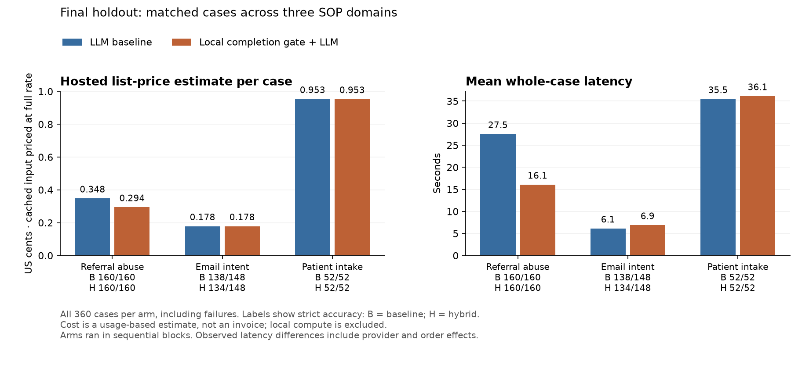
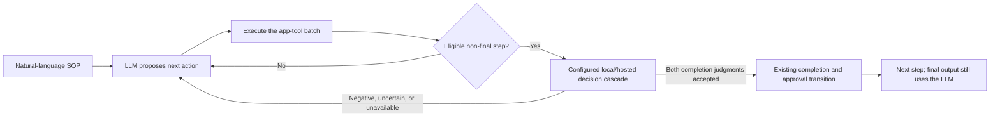
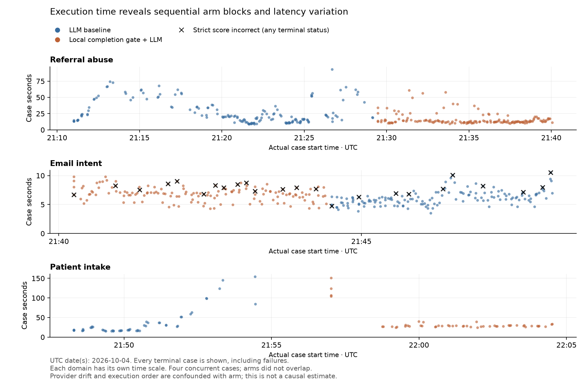

# Configurable decision cascades inside Proceda

Prepared on 2026-10-04. Decision-model support is implemented behind Proceda's
existing natural-language SOP and `Agent` interface. The design was committed
before implementation, and the final candidate was frozen before the full
held-out comparison: **720 executions, 360 per arm, across three SOP-Bench domains**.

**The requested broad accuracy-preserving improvement was not achieved by the
always-on candidate.** It passed 346/360 cases versus the LLM-only baseline's
350/360. The useful result is narrower: referral abuse passed 160/160 in both
arms while removing 187 hosted calls (14.61%) and reducing the full-rate API cost
estimate by 15.39%. Observed referral mean latency fell 41.60%, but sequential
blocks and substantial provider timing drift prevent attributing that entire
change to the decision model.

Email passed 134/148 versus 138/148, with no accepted completion checks, the same
number of hosted calls, and added latency. Patient intake passed 52/52 in both
arms, also with no accepted checks. Across all domains, the full-rate API estimate
fell 6.51% and observed mean latency fell 23.53%, alongside the four additional
strict failures. The detailed results below distinguish avoided calls, estimated API costs,
local inference work, observed timing, and strict correctness. They do not treat
statistical nonsignificance as accuracy equivalence or list-price estimates as
account invoices.

The deployment recommendation is selective: enable the demonstrated completion
optimization for the referral SOP and retain the ordinary LLM path where the
checks provide no useful coverage. That recommendation is not a separately
executed combined-policy experiment. All unsuccessful development attempts and
raw traces are retained alongside the final results.



## Question and implementation

Can an enterprise SOP remain ordinary natural language while a configurable
runtime chooses between generative models and bounded decision models internally?
The practical target is a redundant LLM continuation: after tools have already
completed a step, the LLM often needs another generation merely to acknowledge
completion. A bounded decision model might identify that state at lower expense.

The design was saved before implementation, in commit `1316fbe`, in
`docs/decision-model-cascades-design.md`. The background is the discussion in the
two linked [videos](https://youtu.be/HBVInCcfH1c)
([second video](https://youtu.be/MCc8vpD7doQ)),
[specialized harness engineering](https://enchiridionlabs.online/specialized-harness-engineering.html),
and [SOP-Bench results](https://enchiridionlabs.online/sop-bench-results.html).
Proceda's existing `Agent` and natural-language `SKILL.md` interface remains the
author-facing abstraction. Backend endpoints, models, thresholds, and fallback
order live in configuration rather than the SOP.

The implemented completion path evaluates the current non-final step against
observed tool receipts. Two bounded judgments cover satisfied obligations and
whether normal advancement is appropriate. Both must clear the configured
threshold, 0.97 in these experiments. Uncertainty, errors, unsupported input, or
truncation return control to the ordinary LLM loop. Accepted checks advance through
the existing completion/approval machinery; they do not re-execute tools. Final
answer generation remains explicit. Registry-derived aliases and execution
receipts ground tool identity, arguments, and results; later development hardened
receipt provenance against reused provider tool-call IDs and retained human answers.



This diagram shows the completion optimization. Proposal verification, described
below, is a separate optional check before dispatch. SOP authors do not specify
this graph or choose a model at each step.

The runtime also supports optional proposal verification and bounded generative
repair. Completed proposal-verification-only and combined ablations failed both
patient cases per hybrid arm because of a source-schema inconsistency and later
context-guard failures. Verification is excluded from the final candidate.
**Stronger generative fallback and stronger-LLM-only task ablations are not
reported.** Their design and unit tests are not empirical quality gains.

Jev supplies hosted bounded decisions. Ollaya supplies the local Winnow models.
Nebius Token Factory supplies the generative LLM. This implementation makes no
claim that Jev weights are locally available, that these models were fine-tuned
for this experiment, or that model confidence is a calibrated correctness guarantee.

### Public authoring example

An application continues to provide ordinary steps and its existing MCP tools.
For example, a hypothetical order-status skill can remain:

```markdown
---
name: order-status
description: Look up the customer's latest order and explain its shipping status.
required_tools:
  - orders__get_latest_order
  - shipping__get_shipping_status
---

### Step 1: Find the order
Use the authenticated customer_id to retrieve their latest order. Retain its
order ID. If no order exists, explain that outcome without inventing an order.

### Step 2: Check shipping
For an existing order, retrieve shipping status using its observed order ID.
Retain the returned status and any estimated delivery date.

### Step 3: Respond
Tell the customer the order ID, status, and available delivery estimate. Explain
any missing information. Do not invent a date.
```

The application uses the same public SDK regardless of cascade choice. The tool
names above are illustrative and must match the application's MCP registry:

```python
from proceda import Agent, ProcedaConfig, TerminalHumanInterface

agent = Agent.from_path(
    "skills/order-status/SKILL.md",
    config=ProcedaConfig.load("proceda.yaml"),
    human=TerminalHumanInterface(),
)
result = agent.run(variables={"customer_id": authenticated_customer_id})
```

The following deployment configuration fragment, alongside the application's
existing `apps` definitions, orders local decisions before hosted Jev and ordinary
LLM continuation. It also shows opt-in proposal verification with at most one
repair using the primary LLM. This illustrates the supported configuration;
it is not a claim that this particular profile is production-validated.

```yaml
llm:
  model: openai/zai-org/GLM-5.3-Flash
  api_base: https://api.tokenfactory.nebius.com/v1
  api_key_env: NEBIUS_API_KEY
  reasoning_effort: low
  temperature: 0.0
  max_tokens: 2048
  timeout: 90
decisions:
  enabled: true
  threshold: 0.97
  fast_completion: true
  verify_proposals: true  # Optional; false for the completion-only experiments.
  max_repairs: 1
  backends:
    - name: local
      kind: ollaya
      model: winnow:e4b
      base_url: http://127.0.0.1:11435
      api_key_env: OLLAYA_API_KEY
      timeout: 45
      max_input_chars: 18000
      input_cost_per_million: 0.0
    - name: jev
      kind: typesafe
      model: jev-1.13.0
      base_url: https://api.typesafe.ai
      api_key_env: TYPESAFE_API_KEY
      timeout: 20
      max_input_chars: 60000
      input_cost_per_million: 0.042
```

If a completion check remains uncertain, normal LLM execution continues. Proposal
verification instead checks a generated candidate and can request a bounded repair;
it does not accept a proposal merely because the last available model produced it.
An uncertain, oversized, or unavailable initial verifier permits the original
primary proposal to continue. After a confirmed rejection, an unverified repair
fails explicitly. This advisory fallback is not fail-closed certification of all
actions.
A separate `fallback_llm` configuration can select a stronger repair generator.
The experiment moved to local-only completion candidates because Jev added no
accepted coverage on the tested development inputs. Jev integration was actually
called and traced with reported usage in the earlier arms; removing that stage is an
experimental routing choice, not an unimplemented provider stub.

## Benchmark, source provenance, and partition

The source is [Amazon Science SOP-Bench](https://github.com/amazon-science/SOP-Bench),
pinned at `f6d43858b94cf439854038101bce0eecd3e16eae`. Its complete source archive,
license, and revision marker are preserved under `source/SOP-Bench/`. The original
Proceda baseline commit is `5dfc2b9`; each actual run records its own current code
commit and source-file hashes. Both arms use the same current hardened harness,
shared skills, MCP bridge, primary LLM, inputs, and upstream tools. The baseline
is a disabled-feature ablation in this same harness, not execution of the literal
old `5dfc2b9` binary. Infrastructure fixes therefore apply equally to both arms.

| Domain | Required output fields | Development | Frozen holdout | Total |
| --- | --- | ---: | ---: | ---: |
| Referral abuse v1 | Enforcement action | 40 | 160 | 200 |
| Email intent | Seller intent and action | 38 | 148 | 186 |
| Patient intake | Six validation/risk/registration/pharmacy outputs | 14 | 52 | 66 |
| **Total** | | **92** | **360** | **452** |

Domains were selected before model results. Referral exercises finite decisions,
tool gathering, and precedence. Email adds language classification and conditional
retrieval. Patient intake exercises six dependent checks and is a useful control
where the optimization may save little.

`source-manifest.json` records source SOP, tool implementation/schema, metadata,
CSV and shared-skill hashes, plus exact partition IDs. The partition is label-blind
and deterministic, with seed `proceda-decision-cascades-2026-10-04-v1`; previously
inspected IDs were forced into development. Email rows with the same product ID
stay in one partition. The canonical JSON manifest hash used by run records is
`622c670bcf83dbd2e57a4842c7cccfa226cd6c64e094adcdb418bba2d9d2fdef`.
This is distinct from a hash of the pretty-printed file bytes.

No training occurs. Development may guide prompts, routing, thresholds, and model
choice; held-out results may not guide subsequent tuning while retaining the
claim of untouched validation. These public tasks and historical skills have been
studied before. The partition is a newly frozen experimental holdout, not a claim
that the examples were unknown to the model or experimenter.

The shared source-derived skills were corrected before comparison, using SOPs and
tool schemas: referral uses the upstream closure-category precedence rule, and
patient intake fixes nonexistent prescription input references and requests all
six outputs. The same skill text is used in every arm. No task IDs, expected
labels, or domain-specific decision arithmetic are added to the runtime.

## Models, profiles, and cost assumptions

The initial profiles are LLM-only, Jev completion→LLM continuation, and local
Winnow e4b→Jev→LLM continuation. Later local-only profiles remove Jev when the local
model abstains. All profiles retain the same primary generative model within a
comparison. The low-effort profiles explicitly set `reasoning_effort: low`,
temperature 0, maximum output 2,048 tokens, at most two outer retries, and a
90-second LLM timeout. The local e4b and 12B profiles differ in local model and
local timeout; neither uses a hosted decision fallback.

| Provider/model | Role in recorded experiments | Input USD / million tokens | Output USD / million tokens |
| --- | --- | ---: | ---: |
| Nebius `zai-org/GLM-5.3-Flash` | Shared primary LLM | 0.15 | 0.50 |
| TypeSafe `jev-1.13.0` | Hosted bounded decision stage | 0.042 | 0 |
| Ollaya `winnow:e4b` | Local completion checks | 0 marginal API fee | 0 marginal API fee |
| Ollaya `winnow:12b` | Larger local development candidate | 0 marginal API fee | 0 marginal API fee |
| Nebius `Qwen/Qwen3-30B-A3B-Instruct-2507` | Discovery/tool smoke only | 0.10 | 0.30 |
| Nebius `Qwen/Qwen3-235B-A22B-Instruct-2507` | Discovered fallback option; no task result here | 0.20 | 0.60 |
| Nebius `zai-org/GLM-5.3` | Discovered fallback option; no task result here | 1.40 | 4.40 |

Prices are the recorded list-rate assumptions, not reconciled account invoices.
The saved catalog, pricing metadata, documentation snapshots, and initial tool-call
smoke audits are under `discovery/`. Provider and model IDs are recorded in each
attempt. Hosted weights and serving infrastructure can change even when a model
alias does not. [Nebius GLM catalog](https://nebius.com/services/token-factory/models/glm-models-inference)
and [Qwen catalog](https://nebius.com/services/token-factory/models/qwen-models-inference)
are the public pricing references. TypeSafe's
[Jev announcement](https://typesafe.ai/blog/introducing-system-one-models-and-jev)
lists $0.042 per million input tokens and free output; that assumption is
preserved in each experimental Jev backend configuration.

**Cache-pricing limitation:** the displayed estimates charge every input token at
the ordinary input list rate, including provider-reported cache hits. All 573
LLM calls in `dev-low-8` have cache fields, but no official separate cached-input
rate has been established. Under the hypothetical sensitivity assumption that
cached input is free, that batch's baseline estimate is $0.022524900 and e4b's is
$0.024083250: the apparent e4b saving reverses. This is not a claim that Nebius
actually uses that tariff. Report confirmed full-rate estimates and explicit
cache-rate sensitivity separately until billing can be reconciled. In this batch,
the e4b comparison breaks even at a hypothetical $0.04169 per million cached
tokens; the 12B comparison breaks even at $0.02974. The analyzer's
`cost_usd_lower_bound` is a known subtotal under its selected price assumptions,
not a lower bound on an actual invoice if discounts apply. See
[the cache-pricing review](discovery/cache-pricing-review.md) for evidence.

**Hosted API fees are not total operating cost.** Local hardware, electricity,
idle capacity, depreciation, hosting, and operational overhead are unmeasured.
The local machine is recorded as an 18-core Apple M5 Pro with 64 GiB RAM; Winnow
e4b uses approximately 8 GB on Metal. Native local `total_duration`,
`load_duration`, and `eval_duration` are reported separately in seconds, converted
from Ollaya's nanoseconds. Components are not added to total again. Missing
durations stay unknown, with a known-call count for each metric.
Summed request durations are not a measurement of GPU utilization or energy and
need not equal elapsed device-hours when requests overlap or queue. The
"active model-hour" break-even figures below use that reported-duration proxy;
they are not measured hardware operating costs.

## Scoring, timing, and accounting

A case succeeds only if its runtime status is completed and every required field
matches the expected normalized value. Normalization casefolds and trims strings
and maps spaces/hyphens to underscores. Only explicit assistant or step-summary
structured output is extracted. There is no substring credit, label-bearing
tool-output shortcut, model-based grading, or unpaid fallback extraction. A
failed session containing a correct partial answer still fails.

Expected outputs are stored in a separate `expected.json` and used by the scorer.
Only declared input columns enter Agent variables. Upstream mock tool managers
may read labeled CSVs to implement their prescribed lookup behavior; this is a
property of the simulator, not permission to send extra expected fields to models.

Cost comes from every provider audit attempt, including retries, rejected stages,
and failures with reported usage. Runtime token counters are not the billing
source. LLM `completion_tokens` includes reasoning where reported; reasoning
details are never charged twice. Unknown usage or cost is not zero: reports retain
known subtotals and use null for incomplete exact totals. Decision `request_sent`
means the transport attempt started, not proof of server receipt. Preflight skips
are counted separately.

Case latency covers execution through completed MCP cleanup, including decision
checks, tool work, provider waits, and retries. Early runs before the cleanup fix
are not pooled with later timings. Report mean, median, and interpolated p95
latency as well as schedule wall time/throughput. Four concurrent cases share local
compute and provider capacity; their per-case latency is not serial latency.
Arms run in sequential blocks, with order rotated across domains.

The offline analyzer pairs identical `(domain, task_id)` keys, reports pending and
unpaired cases, and rejects repeated case IDs when merging runs. It computes
nominal 95% Wilson intervals for observed strict accuracy, exact paired
discordance counts/McNemar tests, and 2,000 seeded paired bootstrap resamples for
mean cost and latency differences. Unknown-cost pairs are excluded explicitly.
These intervals assume case-level independence, do not capture repeat-run or
provider/order variation, and may be too narrow for correlated examples. A
nonsignificant difference is not evidence of equivalence.

## Development record: successful and unsuccessful experiments

### Initial referral smoke: correct tasks, ineffective gate

`dev-initial-referral` ran two referral development cases per arm, in fixed order:
baseline, Jev, local→Jev. All six executions passed; every gate abstained.

| Arm | Strict success | LLM attempts | Decision attempts | Hosted API USD | Mean case seconds |
| --- | ---: | ---: | ---: | ---: | ---: |
| Baseline | 2/2 | 16 | 0 | 0.010129600 | 20.529 |
| Jev→LLM | 2/2 | 16 | 6 Jev | 0.009711070 | 17.790 |
| Local→Jev→LLM | 2/2 | 16 | 6 local + 6 Jev | 0.010122486 | 20.284 |

With zero accepted gates, no continuation was replaced. Token and timing
differences are generation/provider variation, not evidence of a working
optimization. This run also exposed the asynchronous MCP cleanup race, so these
timings are retained descriptively rather than pooled with corrected-harness data.
Evidence: `analysis/dev-initial-referral-{jev,local}.json` and
`analysis/dev-initial-referral-gates.json`.

### Normalized receipt candidate: a small cost signal, slower mean latency

The next formulation removed generated conversation ambiguity from the gate,
supplied original receipts and registry-derived tool aliases, and separated
completed business work from the runtime's acknowledgment. The threshold stayed
at 0.97. The corrected harness ran two cases in each domain, one case at a time,
with rotating arm order. All 18 executions passed.

| Arm, six cases each | Strict success | LLM attempts | Local / Jev attempts | Auto-completions | Hosted API USD | Mean / median / p95 seconds |
| --- | ---: | ---: | ---: | ---: | ---: | --- |
| Baseline | 6/6 | 51 | 0 / 0 | 0 | 0.038267250 | 18.080 / 18.412 / 26.711 |
| Jev→LLM | 6/6 | 50 | 0 / 20 | 0 | 0.039016488 | 16.946 / 18.286 / 23.557 |
| Local→Jev→LLM | 6/6 | 46 | 20 / 16 | 4 | 0.035642532 | 18.699 / 18.176 / 29.368 |

All four accepted completions came from the local model on referral cases;
referral LLM attempts fell from 16 to 12. Jev accepted no gate, including after
local abstention. A separate patient difference of 27 versus 26 LLM attempts
occurred without acceptance and is not attributed to the fast path.

The local cascade's full-rate list-price estimate fell 6.86%, while mean latency rose 3.42%
and p95 also increased. The paired mean cost difference was −$0.000437453 per
case, with a bootstrap interval of approximately [−$0.000982451, +$0.000036026].
The paired mean latency difference was +0.619 seconds, interval [−1.346, +2.312].
Each arm's 6/6 accuracy has a Wilson interval of approximately 61.0%–100%.
These tiny samples support neither a population accuracy guarantee nor a
demonstrated joint cost-and-latency improvement.

All 20 local calls reported native durations: 12.976 seconds total, 12.970 seconds
evaluation, and explicitly zero loading. Dividing the $0.002624718 reduction in
the full-rate API estimate by additional native active time gives approximately
**$0.728 per active model-hour** as a break-even sensitivity figure. This is not a provisioned-hour
price, a hardware recommendation, or TCO; idle resources and operating costs are
absent, and the savings themselves have substantial uncertainty.

Evidence: `analysis/dev-v2-smoke-aggregate.json`, six
`analysis/dev-v2-<domain>-<candidate>.json` reports, and the reproducible merged
comparison `analysis/dev-v2-smoke-paired-hybrid-local-jev.json`.

### Decision-only replay and local model choice

Development replay used six completed receipt sets plus seven deliberately
incomplete counterexamples. These are diagnostic fixtures, not extra successful
SOP-Bench tasks and not a statistical calibration set.

| Replay | Model | Completed fixtures accepted | Incomplete fixtures falsely accepted |
| --- | --- | ---: | ---: |
| Completion v2 | Jev | 0/6 | 0/7 |
| Completion v2 | Winnow e4b | 4/6 | 0/7 |
| Completion v3 | Jev | 0/6 | 0/7 |
| Completion v3 | Winnow e4b | 3/6 | 0/7 |
| Completion v3 | Winnow 12B | 6/6 | 0/7 |

A wrong-tool e4b counterexample scored 0.9694, immediately below the 0.97
threshold; the threshold was not lowered. Winnow 12B's first replay call took
6.756 seconds and its remaining calls averaged 1.314 seconds, compared with
roughly half a second for warm e4b calls. Better fixture coverage may be offset
by higher local latency. The preserved `replays/*/manifest.json`, fixtures,
summaries, and provider audits document exactly which formulation was evaluated.

### Aborted concurrency probe: excluded from comparative conclusions

`dev-local-8` attempted four concurrent cases per arm. Its eight baseline referral
cases completed correctly, each using eight successful provider requests and no
retries, but took 62.65–98.26 seconds each. Four hybrid cases had started when the
driver was stopped. Installed LiteLLM code confirmed that its process-global
logging worker could replace active task state as the threaded harness switched
between concurrent event loops. Provider queueing may also have contributed;
the logging race alone is not claimed to explain all latency.

This is an unsuccessful infrastructure probe, not an accuracy or efficiency
comparison. `runs/dev-local-8/aborted.json` records the stop and preservation
policy. Existing partial traces remain; in-flight usage at termination may be
unreported. The revised scheduler uses one asyncio event loop with a semaphore.
Write-ahead provider audit records now preserve started attempts before dispatch.
Earlier interrupted requests without such records cannot be retroactively
declared fully accounted.

### Explicit low reasoning effort: a more competitive LLM-only baseline

The [GLM-5.3-Flash model card](https://huggingface.co/zai-org/GLM-5.3-Flash/blob/main/README.md)
documents `low`, `high`, and `max`, with upstream default `max`.
[Z.ai documentation](https://docs.z.ai/guides/capabilities/thinking-mode) says
thinking cannot be disabled for this model. The hosted endpoint's unspecified
default was not independently established. Nebius documents an explicit
[`reasoning_effort` field](https://docs.tokenfactory.nebius.com/api-reference/inference/create-chat-completion).
Installed LiteLLM 1.82.0 also requires `allowed_openai_params=["reasoning_effort"]`
for this custom OpenAI-compatible model; the low-effort configuration forwards it.

The repaired one-loop `dev-effort-probe` compared four referral cases at four
workers, first baseline with unspecified effort, then baseline-low. Both had
decisions disabled and both passed 4/4.

| LLM-only profile | LLM attempts | Input / output tokens | Hosted API USD | Mean / median / p95 seconds |
| --- | ---: | ---: | ---: | --- |
| Unspecified effort | 33 | 101,027 / 10,807 | 0.020557550 | 47.037 / 45.123 / 59.761 |
| Explicit low | 32 | 85,710 / 1,851 | 0.013782000 | 20.091 / 19.867 / 21.569 |

The full-rate list-price estimate fell 32.96% and mean latency fell 57.29%. Output tokens also
fell substantially. This supports using explicit low effort for subsequent
development, but fixed order, four examples, and shared-provider variability
limit causal precision. **This is a baseline configuration improvement, not a
decision-cascade win.** Evidence: `analysis/dev-effort-probe.json` and its saved
schedule. Earlier unspecified-effort results are preserved, not relabeled.

### Larger low-effort development comparison: estimated API savings with latency regression

`dev-low-8` completed eight development cases per domain in `baseline-low`,
`hybrid-local-low`, and `hybrid-local-12b-low`: 24 cases per arm and 72 executions
in total. All arms use explicit low GLM effort and four case workers;
blocks are sequential, and the three-arm order rotates across domains.

| Arm | Strict success | LLM / local attempts | Hosted API USD | Mean / median / p95 seconds | Native local total seconds |
| --- | ---: | ---: | ---: | --- | ---: |
| Baseline-low | 24/24 | 204 / 0 | 0.120483300 | 15.781 / 14.663 / 34.703 | Not applicable |
| Local e4b-low | 24/24 | 193 / 78 | 0.116435250 | 22.260 / 15.643 / 47.203 | 105.158 |
| Local 12B-low | 23/24 | 176 / 79 | 0.107922900 | 31.596 / 23.145 / 73.431 | 394.081 |

The e4b candidate reduced the full-rate list-price estimate by 3.36% and removed
11 LLM attempts, with 41.06%
higher mean latency. Its 11 accepted gates were referral read steps; all six email
and all 48 patient completion checks abstained. The paired mean fee difference
was −$0.000168669 per case, bootstrap interval [−$0.000286063, −$0.000067643].
Mean latency rose 6.479 seconds, interval [+0.304, +13.804]. It is a cost-only
development result. Independent review found the 11 accepted receipts grounded
in the correct account, tool, arguments, fields, and step; this small observed
sample is not a general assurance of gate correctness.

The 12B candidate reduced the full-rate list-price estimate by 10.43% but
increased mean latency 100.22%.
Its paired mean fee difference was −$0.000523350, interval
[−$0.000788455, −$0.000267529]; mean latency rose 15.815 seconds, interval
[+6.925, +24.504]. Email case E1086 was a real end-to-end regression: the primary
LLM classified a bulk-pricing question as an incorrect-price concern before any
gate ran. The later gate abstained. Count the failure in this arm, while avoiding
the unsupported claim that an accepted local gate caused it.

Trace review also found two 12B patient acceptances, P100012 and P100015 Step 5,
that treated a pharmacy eligibility result as satisfying an additional requirement
to document special handling. The receipts did not provide special handling
information or explicit confirmation of none. Both cases passed output-field
scoring, exposing the difference between correct benchmark labels and complete
fulfillment of prose obligations. This is a substantive missing-evidence concern.

Both arms share another score limitation: email summaries can claim that a
response template was prepared without including its text or an artifact. The
scorer checks intent and action only. Review additionally found LLM-generated
summaries imitating the gate's authority wording and inventing or reusing receipt
IDs after abstention. Authoritative structured events stayed correct. After this
batch, the model-visible synthetic summary was changed to plain completion text;
gate authority and receipt links remain in structured metadata. That change is
not measured by the saved `dev-low-8` results, which remain unchanged.

Full-rate estimated API savings divided by additional native local time yield approximately $0.139
per active model-hour for e4b and $0.115 for 12B. These remain limited sensitivity
figures excluding idle time and TCO; the 12B figure also accompanies worse task
success and the gate concerns above. The eight canonical aggregate/domain reports
are `analysis/dev-low-8-<candidate>-<scope>.json`. Detailed trace evidence and
limitations are in `analysis/dev-low-8-trace-review.md`.

### Verification ablation: explicit failures on a source-schema inconsistency

Following commit `161742d`, `dev-verification-smoke` compared `baseline-low`,
`hybrid-local-verify-low`, and `hybrid-local-both-low` on two development cases per
domain, with four workers and rotating sequential arm order: 18 executions.

| Arm | Completed and strictly correct | LLM / decision attempts | Decision preflight records | Full-rate API estimate USD | Mean / p95 case seconds |
| --- | ---: | ---: | ---: | ---: | --- |
| Baseline-low | 6/6 | 51 / 0 | 0 | 0.029791850 | 12.969 / 20.035 |
| Verification only | 4/6 | 28 / 15 | 11 | 0.013181050 | 13.222 / 26.408 |
| Verification plus completion | 4/6 | 25 / 21 | 10 | 0.011858250 | 14.157 / 26.643 |

All arms passed referral and email. Both hybrid modes failed both patient cases.
The source schema requires patient identifiers matching `^P[0-9]{9}$`, while the
actual dataset supplies six digits, for example `P100002`, which the original tool
implementation accepts. Strict proposal schema validation rejected the observed
IDs. Repaired proposals could not be verified inside the configured context
guard, leading to explicit failure before app-tool execution. The lower expenses
of these failed runs are not an efficiency improvement at comparable quality.

The source inconsistency and failures are retained, without weakening the schema
or changing frozen skills to improve scores. Verification provided no observed
benefit on this small development set and remains optional rather than part of
the final profile. The eight aggregate/domain reports are
`analysis/dev-verification-smoke-<candidate>-<scope>.json`; detailed repair and
failure analysis should accompany these summaries. No stronger generative fallback
is implied by these profile names.

## Frozen final profile and held-out results

`FINAL_PROFILE.md` records
selection before inference, based only on development. The source code freeze is
`161742d`; the launch commit containing the freeze record is `00ae813`. The
`holdout-final` schedule started at `2026-10-04T21:11:00.832306+00:00`.

| Freeze item | Status |
| --- | --- |
| Baseline | `configs/baseline-low.yaml`; decisions disabled |
| Candidate | `configs/hybrid-local-low.yaml`; e4b completion only |
| Baseline YAML SHA-256 | `dd7373fa3d72c1b349e7c6b0dfe4a350644c6cd3a28dbdf449148f4ff315ec4b` |
| Candidate YAML SHA-256 | `afd999d56833a69103c35ea7efbbe1eff196ab1c041c080351cda022125077bd` |
| Selection rationale | 24/24 observed e4b development success, 11 reviewed avoided LLM calls; conditional API-fee saving with disclosed slower latency |
| Source identity | Implementation `161742d`, launch `00ae813`; exact hashes in each arm's `run.json` |
| Generative configuration | GLM-5.3-Flash, low effort, temperature 0, maximum 2,048 output tokens |
| Decision configuration | Winnow e4b, threshold 0.97, 18,000-character guard, 45-second timeout |
| Schedule | `runs/holdout-final/schedule.json`; four workers, one event loop, sequential rotating arm blocks |
| Local state | Only e4b receives requests; no concurrent model experiment. Both models were observed resident earlier, but a later read-only check showed only e4b. Continuous 12B residency was not established. |
| Verification/fallback status | Verification ablations completed and not selected; no stronger-generative-fallback result claimed |

| Held-out domain | Cases per arm | Baseline success | Candidate success | Paired regressions / improvements | Full-rate API estimate difference | Mean / p95 latency difference |
| --- | ---: | --- | --- | --- | --- | --- |
| Referral abuse v1 | 160 | 160/160 | 160/160 | 0 / 0 | −15.39% | −11.452 s / −28.054 s |
| Email intent | 148 | 138/148 | 134/148 | 6 / 2 | +0.08% | +0.769 s / +0.367 s |
| Patient intake | 52 | 52/52 | 52/52 | 0 / 0 | −0.04% | +0.671 s / −5.091 s |
| Overall | 360 | 350/360 | 346/360 | 6 / 2 | −6.51% | −4.677 s / −27.991 s |

All 720 executions completed; no whole-case retry, pending case, outcome-based
exclusion, provider error, or unknown-usage request remains in this schedule.
The source skills, runtime, task IDs, and model configuration remained fixed.
The full [aggregate analysis](analysis/holdout-final.json) pairs all 360 IDs.

| Domain | Hosted calls, baseline → candidate | Local checks / accepted | Full-rate API USD, baseline → candidate | Mean seconds, baseline → candidate | Median seconds, baseline → candidate |
| --- | ---: | ---: | ---: | ---: | ---: |
| Referral abuse | 1,280 → 1,093 | 480 / 187 | 0.5564789 → 0.4708285 | 27.526 → 16.074 | 20.409 → 13.026 |
| Email intent | 555 → 555 | 111 / 0 | 0.2638881 → 0.2641041 | 6.120 → 6.890 | 5.989 → 6.951 |
| Patient intake | 699 → 699 | 312 / 0 | 0.4957260 → 0.49553245 | 35.464 → 36.135 | 19.328 → 28.612 |
| **Overall** | **2,534 → 2,347** | **903 / 187** | **1.3160930 → 1.23046505** | **19.873 → 15.196** | **12.880 → 11.570** |

Overall accuracy was 97.22% versus 96.11%, a 1.11-percentage-point decrease;
Wilson intervals are 94.96%–98.48% and 93.58%–97.67%. There were 344 pairs correct
in both arms, eight incorrect in both, two improvements, and six regressions.
All discordant correctness outcomes were in email. The exact McNemar p-value is
0.289, with no accuracy-equivalence conclusion.

The paired mean full-rate cost difference was −$0.000237855 per case, interval
[−$0.000268137, −$0.000208208]. At hypothetical free-cache prices, aggregate
estimates were $0.3284834 and $0.29638505 (−9.77%); at 20% cache prices,
$0.52600532 and $0.48320105 (−8.14%). There is no cost crossover between zero and
full ordinary input rate in this held-out aggregate. This differs from the
development batch, whose apparent saving reversed with free caching.

The paired mean latency difference was −4.677 seconds, interval [−6.859, −2.455];
aggregate p95 changed from 60.930 to 32.939 seconds. These aggregate improvements
are weighted by the frozen domain mix and remain confounded by sequential block
timing. The median paired latency change was **+0.278 seconds**, despite the
lower aggregate mean and lower unpaired medians: large referral differences and
provider tails pull down the mean. Do not interpret the average as every task
getting faster.

The candidate accumulated 1,357.125 seconds of native local total duration,
including 4.144 seconds of reported loading and 1,342.017 seconds of evaluation.
The aggregate full-rate saving divided by this duration yields a $0.227 per
active model-hour break-even proxy, excluding idle capacity and all other TCO.

### Referral: fewer hosted calls with matching observed final correctness

The completed referral comparison is in
[its canonical analysis](analysis/holdout-final-referral_abuse_detection_v1.json).
The baseline/candidate full-rate cost estimates are $0.5564789/$0.4708285.
The candidate removed 187 hosted calls and added 480 local checks, with 605.46
seconds of summed native local inference. Its 187 accepted checks comprised
158 Step 1 and 29 Step 2 completions; independent receipt review found no
tool, account, argument, required-field, or provenance mismatch. Both final-action
distributions were 74 No Action and 86 Account Closure.

The referral cost advantage holds at hypothetical free-cache and 20%-of-normal
cache rates: $0.1608053/$0.1360189 and $0.23994002/$0.20298082, respectively.
The paired mean full-rate cost difference was −$0.000535315 per case, with a
nominal 95% bootstrap interval [−$0.000558716, −$0.000512398]. Mean latency changed
by −11.452 seconds, interval [−14.359, −8.607]; median changed from 20.409 to
13.026 seconds and p95 from 62.066 to 34.012 seconds. These intervals describe
case variation and do not remove provider/order confounding. Each arm's 160/160
strict accuracy has a Wilson interval of approximately 97.66%–100%.

The absolute referral saving is small: $0.0856504 for 160 cases under the full-rate
estimate, or about $5.35 per 10,000 cases at the same workload mix. Dividing it by
605.46 summed native local seconds gives roughly $0.509 per active model-hour
as a break-even proxy; the hypothetical free-cache assumption reduces that to
approximately $0.147. This is useful routing evidence, but it does not establish
that purchasing or provisioning local hardware saves money overall.

Correct final labels do not establish correct intermediate reasoning. In referral
case `ACC100008`, the candidate's Step 4 reported No Violation = 0 instead of 1,
despite an observed `address_validity: true`, which the SOP scores as one. Its
final closure action remained correct because another category independently
required closure. The accepted Step 1 gate had complete, correctly identified
receipts; the arithmetic error occurred later in an LLM summary. It remains a
quality limitation even though the benchmark's final field passes.

### Email: no useful completion coverage, slower execution, lower observed accuracy

The [complete email comparison](analysis/holdout-final-email_intent.json) passed
138/148 baseline cases (93.24%) and 134/148 candidate cases (90.54%). There were
132 pairs correct in both arms, eight incorrect in both, two improvements, and
six regressions. The exact McNemar p-value is 0.289; this does not establish
equivalence or erase the observed 2.70-percentage-point decrease. Wilson accuracy
intervals are 88.01%–96.29% and 84.75%–94.28%, respectively.

Both arms made 555 hosted calls. The candidate added 111 local checks and accepted
none, using 96.625 seconds of summed native local time. Full-rate API estimates
were $0.2638881 and $0.2641041, a 0.08% increase; the paired per-case difference
was +$0.000001459, interval [−$0.000003790, +$0.000006630]. At hypothetical free
cache, estimates were $0.0816801 and $0.0934929 (+14.46%); at 20% cache price they
were $0.1181217 and $0.12761514 (+8.04%). The measured cost change is not a
continuation-saving effect because no continuation was replaced.

Mean latency rose from 6.120 to 6.890 seconds (+12.57%); median rose from 5.989 to
6.951 seconds and p95 from 8.497 to 8.864 seconds. The paired mean increase was
0.769 seconds, interval [0.552, 0.996]. These are end-to-end observations from
sequential blocks, with the same provider/order limitations as the other domains.

The candidate's fourteen failures comprised ten requests whose missing replacement
details led to clarification instead of the oracle's description update; one
sparse-catalog comparison (`E1096`); one exact label drift (`E1133`, dropping
“their” from the required intent); and two intent/taxonomy errors (`E1012`,
`E1066`). The raw score remains unchanged even where clarification is defensible
from the supplied information. All incorrect candidate runs had zero accepted
gates. Differences arose in generative responses, without evidence that a local
acceptance caused them. They still count against the complete candidate system.

The six regressions were `E1066`, `E1096`, `E1133`, `E1164`, `E1176`, and `E1224`;
the two improvements were `E1088` and `E1264`. Independent review found no wrong
retrieval identifiers or extraction mismatch. Case-level evidence, including the
baseline failures and shared ambiguities, is in
[the gate and failure review](analysis/holdout-final-gate-review.md).

### Patient: matching final fields, no useful completion coverage

The [complete patient comparison](analysis/holdout-final-patient_intake.json)
passed 52/52 cases in both arms, with every one of the six required fields correct
in every case. Each arm's Wilson accuracy interval is 93.12%–100%. The candidate
accepted none of its 312 local checks; both arms made 699 hosted requests.
Thus no LLM continuation was replaced in this domain.

Full-rate API estimates were $0.4957260 and $0.49553245, a negligible 0.04%
decrease. The paired per-case difference was −$0.000003722, interval
[−$0.000009547, +$0.000001999]. The candidate used 655.041 seconds of native local
total duration, including 3.254 seconds of loading. It provided no demonstrated
completion-saving benefit to offset this work.

Mean latency rose from 35.464 to 36.135 seconds (+1.89%); the paired mean change
was +0.671 seconds, interval [−11.886, +12.190]. Median rose from 19.328 to
28.612 seconds (+48.03%), while p95 fell from 110.415 to 105.323 seconds.
The saved timeline shows a large provider slowdown near the end of the baseline
and start of the candidate, followed by recovery without intervention. Examples
include baseline `P100085` (123.806 seconds, 123.559 inside hosted calls) and
candidate `P100008` (151.47 seconds, about 138.00 hosted and 12.77 local).
Later candidate cases returned to roughly 27–30 seconds. Provider headers were
not captured, so a quota or queueing explanation is plausible but not established.

Hypothetical free-cache estimates were $0.085998 and $0.06687325; at 20% cache
price, $0.1679436 and $0.15260509. These differences reflect cache/token behavior
across blocks, not avoided LLM requests. No claim of a patient decision-model
efficiency win follows from them. As elsewhere, correct scored fields do not
certify every prose documentation obligation.

### Output fields and observed throughput

[The supplemental details](analysis/holdout-final-details.json) report every
required field. Referral enforcement action was correct 160/160 in both arms.
Email seller intent was correct 147/148 versus 145/148, and email action 138/148
versus 135/148; the all-field intersection is 138/148 versus 134/148. Each of the
six patient fields was correct 52/52 in both arms.

| Sequential block | First case start to last case finish, seconds | Terminal cases per minute |
| --- | ---: | ---: |
| Referral baseline | 1,106.284 | 8.678 |
| Referral candidate | 647.439 | 14.828 |
| Email candidate | 255.616 | 34.740 |
| Email baseline | 227.528 | 39.028 |
| Patient baseline | 522.936 | 5.966 |
| Patient candidate | 483.148 | 6.458 |

The recorded span from first case start to last case finish was 3,243.186 seconds
(54 minutes, 3 seconds), or 13.320 terminal executions per minute across the
whole sequential schedule. These are case timestamp spans, not a measurement
of unrecorded driver teardown. Block throughput and mean case latency can move
in different directions because four cases overlap and long tails occupy
different positions in each block.



Both figures include failed cases. PNGs, editable SVGs, generating scripts, and
source hashes are retained under `analysis/figures/` and `analysis/`. The timeline
makes the sequential execution and within-arm timing shifts visible; it does not
estimate the counterfactual latency of either arm at the other's execution time.

## What to enable, and what this design does not solve

For the measured referral SOP, enable the e4b completion profile: it replaces
acknowledgment turns after evidence is already available. For email, retain the
LLM-only profile: the added decision requests found no completed steps to advance.
For patient intake, also retain the LLM-only profile: all 312 checks failed to
replace a continuation, and median latency rose substantially. This selection is
deployment advice from the observed evidence, not a third measured experimental
arm. Combining the best whole-domain arms would be a retrospective policy estimate;
it must not be presented as an independently executed three-domain result.

The existing API already permits this configuration per SOP: construct each
`Agent` with the deployment's selected `ProcedaConfig`. The skill remains the
same Markdown and the MCP tools remain the same. No task-label routing, automatic
profile learner, model compiler, or hidden per-domain rule engine was added.
The CLI equivalent is `proceda run <skill> --config <path>`. Supply the deployment's
actual MCP `apps` definitions as well; experimental model-profile YAML relies on
benchmark tools injected by the experiment harness and is not a complete production
application configuration.
The selected completion profile has `fast_completion: true` and
`verify_proposals: false`; setting `decisions.enabled: false` restores the ordinary
generative path. These settings are documented in
[the configuration guide](../../docs/configuration.md).

The main tradeoff is the granularity of the decision. Checking whether an observed
step is complete is easy to add behind the current natural-language abstraction,
and successful checks eliminate real model turns. It cannot generate missing
business reasoning, draft an email, compute an unperformed analysis, or repair
the source task's underspecified intent taxonomy. More aggressive acceptance
would increase coverage at the expense of evidence requirements; the 12B pharmacy
examples show why final-label accuracy alone is insufficient for choosing it.

Proposal verification solves a different problem and costs another inference
stage. Its current implementation is useful as an optional mechanism with
explicit diagnostics, but these experiments do not justify enabling it by default.
Likewise, a stronger repair LLM is configurable without being a demonstrated
improvement here. Jev remains a working hosted backend; its lack of accepted
coverage in the tested prompts is a result about this formulation, not a general
ranking of decision models.

For broader coverage, the next design question is whether the harness can derive
and validate bounded internal decisions from an SOP before execution, then reuse
that plan. That would require a separate evaluation of plan correctness, versioning,
and amortized compilation cost. This branch deliberately measures a smaller
intervention whose skipped calls and supporting receipts can be inspected.

## Audit retention and known limits

Each arm has a `run.json` recording task IDs, expanded nonsecret configuration,
split, code identity, and source hashes. Cases preserve inputs, separate expected
outputs, incremental events/messages, tool names/arguments/order/results, provider
audits, and authoritative `terminal.json`. Predictions and summaries refer back to
these cases. Provider write-ahead records are finalized atomically; interruption
leaves an explicit started record with unknown usage instead of silently losing a
billable attempt. Missing audit data stays an accounting limitation.

Secrets are supplied from environment or a bounded password-store subprocess in
memory. Audits sanitize credentials and headers rather than preserving bearer
tokens. Large repeated-prompt run directories remain local and ignored by Git;
they are retained rather than deleted. Seven groups, including the explicitly
aborted development probe and the completed holdout, also have immutable compressed
archives and per-file SHA-256 manifests in [archives/](archives/README.md), tracked
on this branch. They preserve **15,754 files**, compressed from **142.69 MB to
11.22 MB**. The holdout alone contains 13,005 files. Exact known-credential scans
passed. Fresh temporary restorations reproduced the development and held-out
counts and complete accounting dictionaries exactly. Source, skills,
configurations, replay fixtures, manifests, and summary analyses are also retained.
Resume requires identical provenance and never overwrites a
terminal case; retrying a partial case requires a new run ID. These controls do
not promise exactly-once enterprise side effects or prove resume safety generally.

The earliest smoke's console cleanup warnings were not all captured in a
standalone driver log. Its saved provider, tool, and session traces are preserved;
later scheduled runs retain the driver's stdout/stderr as well. The aborted
pre-write-ahead probe has explicitly unknown in-flight usage. Neither limitation
is silently repaired or counted as zero cost.

Final repository validation passed `make check`: **505 tests**, Ruff lint and
formatting, and type checking. The [validation log](analysis/final-validation.log)
is retained. The independent [integrity report](analysis/holdout-final-integrity.md)
checked all six arm manifests, 48 frozen runtime/runner file hashes, exact task
IDs, skills, source data, configuration, grades, event sessions, and audit links.
All 720 cases passed these structural checks. The 5,784 provider audit records
comprise 4,881 successful hosted requests and 903 local requests, with no provider
errors, retries, missing usage, or driver warnings. These structural checks are
separate from benchmark correctness and semantic compliance.

Independent semantic review checked all 187 accepted completions, all in referral,
and 2,347 candidate LLM request contexts. It found no accepted gate with a wrong
tool, account, argument, required receipt field, provenance link, or old synthetic
authority wording. All six patient tools executed in order in all 52 candidate
cases. There were 716 abstentions overall. Zero patient/email accepts cannot
establish calibrated gate accuracy for those domains.

Important benchmark limits remain:

- **Email tool/data ambiguity:** fourteen repeated product IDs have conflicting
  row-level catalog fields, while upstream lookups choose the first match. Raw
  benchmark scoring is preserved in both arms. Any source/tool-consistent analysis
  must be labeled separately and cannot replace raw scores to manufacture a win.
- **Patient simulator behavior:** eighteen rows have blank alcohol consumption and
  fourteen have blank exercise frequency. The shared MCP compatibility bridge maps
  empty strings to `N/A`. Tools are benchmark lookups rather than real medical
  services; this is process automation evaluation, not clinical validation.
- **Referral scope:** the task is explicit procedural scoring/precedence, with 105
  Account Closure and 95 No Action labels. It does not establish general judgment
  quality on arbitrary enterprise policies.
- **Simulator versus deployment:** mock tools and deterministic inputs omit real
  authorization, external side effects, variable human approval delays, and many
  enterprise integration failures. Strict final fields do not prove every
  intermediate obligation was satisfied; gate traces need independent review.
- **Provider and order effects:** Nebius public endpoints use shared infrastructure.
  Its [rate-limit documentation](https://docs.tokenfactory.nebius.com/ai-models-inference/rate-limits)
  permits lower-priority processing over nominal limits. One run cannot separate
  generation variance, queueing, cache warmth, and model effects completely.
- **Selection and sample size:** development was reused for tuning and must remain
  separate from held-out claims. Six-case smoke and thirteen-fixture replay results
  are not confidence calibration. Even the frozen held-out domain sizes limit what
  can be said about small accuracy differences or rare failures.

## Reproduction and evidence index

Run commands from the repository root. The inference commands below identify recorded
experiments and will start new paid inference if invoked with fresh run IDs. Run IDs
are immutable artifact names, so use a new ID when reproducing an existing run.
The schedule driver loads credentials in memory and creates its schedule before
inference. Do not put API keys in shell arguments, reports, or config snapshots.

Install the locked Python dependencies with `uv sync --frozen --extra dev` and use the
resulting `.venv`. The recorded schedule driver is specific to this machine: its
credential helper calls `/Users/Vivek.Haldar/.homebrew/bin/pass` and expects
`NEBIUS/TOKEN_FACTORY_API_KEY` and `API_KEYS/TYPESAFE_AI_JEV_API_KEY`. It loads both
entries even for local-only decision schedules. Ollaya must already be serving
on `http://127.0.0.1:11435` with the configured Winnow model installed.

For a different machine, set the configured credential environment variables
through your secret manager and call the portable per-arm CLI directly. For
example, with `NEBIUS_API_KEY` already set, this starts a new development arm
without calling `pass`:

```sh
.venv/bin/python -m benchmarks.sop_bench.paired_experiment \
  --config experiments/decision-cascades-2026-10-04/configs/hybrid-local-low.yaml \
  --arm hybrid-local-low --split dev --domains referral_abuse_detection_v1 \
  --limit 2 --jobs 1 --run-id reproduced-local-smoke
```

Use the same source, skills, case selection, LLM configuration, and concurrency
for a corresponding baseline. Changes in provider availability, local hardware,
or serving versions make a new measurement rather than an exact replay.

Prepare/validate benchmark source without inference:

```sh
.venv/bin/python -m benchmarks.sop_bench.paired_experiment --prepare
```

Recorded explicit-effort development probe:

```sh
.venv/bin/python -m benchmarks.sop_bench.run_paired_schedule \
  --run-id dev-effort-probe --domains referral_abuse_detection_v1 \
  --profiles baseline baseline-low --split dev --limit 4 --jobs 4
```

Recorded larger development schedule:

```sh
.venv/bin/python -m benchmarks.sop_bench.run_paired_schedule \
  --run-id dev-low-8 \
  --profiles baseline-low hybrid-local-low hybrid-local-12b-low \
  --split dev --limit 8 --jobs 4
```

Recompute the completed v2 aggregate comparison offline, without model calls:

```sh
.venv/bin/python -m benchmarks.sop_bench.analyze_paired \
  --baseline experiments/decision-cascades-2026-10-04/runs/dev-v2-smoke--*/baseline \
  --candidate experiments/decision-cascades-2026-10-04/runs/dev-v2-smoke--*/hybrid-local-jev \
  --output experiments/decision-cascades-2026-10-04/analysis/dev-v2-smoke-paired-hybrid-local-jev.json
```

The same analyzer can merge all three `dev-low-8` domains, separately
for each local candidate. It checks frozen split/hash agreement and rejects
overlapping case IDs rather than silently combining repetitions:

```sh
.venv/bin/python -m benchmarks.sop_bench.analyze_paired \
  --baseline experiments/decision-cascades-2026-10-04/runs/dev-low-8--*/baseline-low \
  --candidate experiments/decision-cascades-2026-10-04/runs/dev-low-8--*/hybrid-local-low \
  --output experiments/decision-cascades-2026-10-04/analysis/dev-low-8-hybrid-local-low-aggregate.json
```

Recorded verification-ablation schedule:

```sh
.venv/bin/python -m benchmarks.sop_bench.run_paired_schedule \
  --run-id dev-verification-smoke \
  --profiles baseline-low hybrid-local-verify-low hybrid-local-both-low \
  --split dev --limit 2 --jobs 4
```

Recorded full held-out schedule, with no case limit:

```sh
.venv/bin/python -m benchmarks.sop_bench.run_paired_schedule \
  --run-id holdout-final --profiles baseline-low hybrid-local-low \
  --split holdout --jobs 4
```

Recompute the complete held-out comparison offline:

```sh
.venv/bin/python -m benchmarks.sop_bench.analyze_paired \
  --baseline experiments/decision-cascades-2026-10-04/runs/holdout-final--*/baseline-low \
  --candidate experiments/decision-cascades-2026-10-04/runs/holdout-final--*/hybrid-local-low \
  --output experiments/decision-cascades-2026-10-04/analysis/holdout-final.json
```

The final analyses cover the full frozen holdout only. Development examples and
repeated development runs remain in their own reports and are not pooled into
the 360-case-per-arm accuracy denominator.

Recompute the field/timing supplement and plots without inference:

```sh
.venv/bin/python experiments/decision-cascades-2026-10-04/analysis/final_details.py
uv run --no-project --python 3.12 --with matplotlib==3.11.2 \
  experiments/decision-cascades-2026-10-04/analysis/plot_final.py
```

The isolated plotting dependency does not change the repository lockfile.
Archive verification and restoration instructions are in
[the archive index](archives/README.md); extracting an archive is enough to
recover the original case layout for offline analysis on another machine.

| Evidence | Location relative to this experiment |
| --- | --- |
| Pre-inference protocol and amendments | `PROTOCOL.md` |
| Profile frozen before held-out inference | `FINAL_PROFILE.md` |
| Chronological changes, including unsuccessful work | `ITERATIONS.md` |
| Frozen source/skill hashes and exact split IDs | `source-manifest.json` |
| Shared natural-language SOPs and provenance | `skills/` |
| Every preserved profile | `configs/` |
| Provider discovery and initial smoke evidence | `discovery/` |
| Unverified cached-input tariff and cost sensitivity | `discovery/cache-pricing-review.md` |
| Decision-only replay manifests, fixtures, and results | `replays/` |
| Offline summaries and uncertainty | `analysis/` |
| Complete paired held-out comparison | [holdout-final.json](analysis/holdout-final.json) |
| Fields and execution spans | [holdout-final-details.json](analysis/holdout-final-details.json) |
| Semantic gate and failure review | [holdout-final-gate-review.md](analysis/holdout-final-gate-review.md) |
| Frozen-source and complete-trace verification | [holdout-final-integrity.md](analysis/holdout-final-integrity.md) |
| Plots, SVGs, and figure provenance | `analysis/figures/` |
| Immutable trace archives and restoration instructions | [archives/README.md](archives/README.md) |
| Raw local schedules, cases, traces, and provider attempts | `runs/` (Git-ignored, retained locally) |
