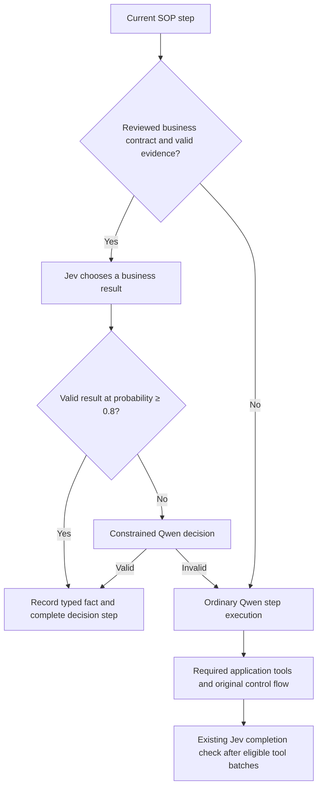

# Bounded business decisions in Proceda

Completed October 4, 2026, Pacific time, on branch `codex/bounded-business-decisions`.

**Direct business-decision routing helped on email: Jev replaced 141 Qwen intent
decisions, reducing email LLM calls by 25.4%, while both business arms scored
148/148.** This is the new result, distinct from the earlier completion-check savings.
Jev handled 95.3% of email intents; seven uncertain cases fell back to Qwen.

Across the entire three-domain process, the full hybrid used **752 fewer LLM calls
(29.6%)**, with **26.6% lower estimated execution API cost** and **19.7% lower mean
case latency** than Qwen-only. Strict correctness was **360/360 versus 357/360**.
The structured Qwen business arm also scored 360/360, so the accuracy improvement
cannot be attributed to native business inference. Referral policy and patient
eligibility did not reach the new decision path; their direct-business coverage is zero.

All 1,440 full executions and 48 separate pilot executions finished. The full runs
took 20 minutes 34 seconds with three parallel domain processes. No provider errors,
unknown usage or trace-integrity errors were found. The pilot is excluded from the
performance tables. These are freshly executed controls on reused validation cases.

## Results across all three domains

A is Qwen-only; B adds Jev completion checks; C adds the structured business interface
but uses Qwen for its decisions; D uses Jev for those decisions with Qwen fallback.

| Domain | A correct | B correct | C correct | D correct | Qwen calls A / B / C / D |
|---|---:|---:|---:|---:|---|
| Referral abuse | 160/160 | 159/160 | 160/160 | 160/160 | 1,280 / 800 / 800 / 800 |
| Email intent | 145/148 | 146/148 | 148/148 | 148/148 | 558 / 557 / 556 / 415 |
| Patient intake | 52/52 | 52/52 | 52/52 | 52/52 | 699 / 572 / 574 / 570 |
| **Total** | **357/360** | **357/360** | **360/360** | **360/360** | **2,537 / 1,929 / 1,930 / 1,785** |

| Arm | Jev requests | Total hosted requests | Estimated execution API cost | Mean case latency |
|---|---:|---:|---:|---:|
| A — Qwen-only | 0 | 2,537 | $6.409988 | 8.642s |
| B — completion checks | 905 | 2,834 | $5.142588 | 7.758s |
| C — business-Qwen | 904 | 2,834 | $4.827737 | 7.265s |
| D — business-Jev | 1,052 | 2,837 | $4.703253 | 6.938s |

These are warm execution estimates at the unchanged protocol rates, including Jev,
but excluding source preparation. **Hosted requests increase even while LLM calls
and estimated cost decrease.** D's 1,052 Jev requests comprise 148 business choices
and 904 completion checks. Its cost comprises $4.64061555 for Qwen and $0.062637582
for Jev. D's overall p95 latency is 15.274s, versus A's 16.064s; improvements are
uneven, particularly in patient intake.

| Domain | A → D execution cost | A → D mean latency |
|---|---:|---:|
| Referral abuse | $2.962259 → $2.050319 | 9.177s → 7.058s |
| Email intent | $1.343104 → $0.919394 | 5.708s → 4.083s |
| Patient intake | $2.104625 → $1.733540 | 15.351s → 14.694s |

The 752-call reduction from A to D decomposes into **480 referral completion
bypasses + 129 patient completion bypasses + 141 direct email decisions + two
other email calls** associated with the structured interface and changed branch
execution. Do not credit all 752 to the new business-decision capability.

The cleaner new-capability comparison is D versus C: email saves exactly 141 calls
with no correctness change. The aggregate C→D reduction is 145 calls; the other four
come from patient completion variation despite zero native business decisions there.
The aggregate execution cost difference is $0.124484 (2.6%); the isolated email
difference is $0.117232 (11.3%). B's 608 fewer calls than A include 607 verified
completion bypasses and one email branch difference, despite zero accepted email checks.

Adding the **full final source-preparation cost of $0.12769755** to either independently
deployed business alternative gives C $4.955435 and D $4.830951 for this 360-case
batch. D remains 24.6% cheaper than A under the stated pricing assumptions. For an
email-only deployment, its relevant preparation is $0.0262911: C and D totals become
$1.062917 and $0.945685, respectively. Historical failed preparation is disclosed below.

The A→D execution-cost reduction is 26.8%, 26.7% or 26.6% under hypothetical cached-input
prices of 0%, 20% or 100% of normal input price. These are sensitivity scenarios,
not verified invoices. [Full paired results and attribution](analysis/full.json).

## Direct business-decision result: email

**Jev replaced 141 Qwen intent decisions, with unchanged 148/148 final-task
correctness against the same business interface using Qwen.** Seven of 148 native
attempts abstained below the 0.8 threshold and used the constrained Qwen fallback.
All 141 accepted intents matched the reference; all seven fallback cases also passed.

Costs in this table are estimated execution API costs, excluding preparation, not invoices.

| Email metric | C — business-Qwen | D — business-Jev | Change |
|---|---:|---:|---:|
| Final tasks correct | 148/148 | 148/148 | No regressions or improvements |
| Qwen intent decisions | 148 | 7 | 141 fewer |
| Other Qwen calls | 408 | 408 | Unchanged |
| **Total Qwen calls** | **556** | **415** | **−25.4%** |
| Jev intent attempts | 0 | 148 | 141 accepted, 7 abstained |
| Jev completion checks | 112 | 112 | All rejected; zero bypasses |
| Total hosted inference requests | 668 | 675 | 7 more, from fallbacks |
| Business-decision API charge | $0.131584 | $0.010282 | −92.2% |
| Whole-email API charge | $1.036626 | $0.919394 | −11.3% |
| Mean whole-case latency | 4.991s | 4.083s | −18.2% |

The call reduction has a direct trace explanation. C calls `record_decision` once
per email. D first calls Jev's finite-choice interface; 141 accepted results produce
settled `native_choice` facts and advance Step 1 without a Qwen call. Seven uncertain
results still make the same constrained call. Every paired catalog call and result
matches, the later Qwen call count is identical, and neither arm receives an accepted
email completion check. Thus **all 141 fewer calls in this comparison are attributable
to direct business decisions**, not completion checking or omitted application tools.

The hosted request count increases because each successful native decision replaces
one hosted Qwen request with one hosted Jev request, while each abstention adds a
Jev request before Qwen. “Fewer LLM calls” therefore does not mean fewer API requests.

The business-stage charge in D is $0.003334296 for all 148 Jev attempts plus
$0.0069474 for seven Qwen fallbacks. C's 148 constrained calls cost $0.13158375.
The other Qwen calls cost $0.8979597 in C and $0.9020304 in D; generation lengths
vary even when call counts match. Completion charges are essentially identical.
This explains why the $0.121302 reduction in business-stage charges is slightly
larger than the $0.117232 reduction for entire email tasks.

Constrained Qwen business calls took a median 1.028s of provider time; native Jev
calls took a median 0.190s. Summed business-provider time changed from 160.05s to
36.22s including fallbacks. Those sums are not wall-clock benchmark duration under
concurrency; the whole-case means in the table are the relevant observed task metric.

The paired mean latency change is −0.908s; its 95% percentile bootstrap interval is
−1.160s to −0.675s (2,000 resamples). The paired mean cost change is −$0.000792 per
email, with an interval of −$0.000860 to −$0.000721 at the stated prices. These
describe this reused dataset and run, not a production guarantee or an accuracy
noninferiority test. Hypothetical cached-input rates of 0%, 20% and 100% of ordinary
input pricing give whole-email C→D savings of 22.0%, 17.8% and 11.3%, respectively;
cached-input invoice pricing remains unverified.

### Abstention and confidence

| Email | Jev's top probability | Qwen fallback result |
|---|---:|---|
| E1012 — listing go-live question | 0.76 | Product not listed; share listing status |
| E1102 — bundle-pricing question | 0.51 | Generic; no action |
| E1126 — gift-options question | 0.59 | Generic; no action |
| E1138 | 0.61 | Generic; no action |
| E1194 — gift-wrapping question | 0.69 | Generic; no action |
| E1246 | 0.78 | Generic; no action |
| E1254 — inventory-sync question | 0.49 | Generic; no action |

Jev's unfiltered top label matched 146/148 references. Its wrong top choices were
E1102 (incorrect pricing) and E1126 (unable to decide). Both were below threshold,
so neither became an accepted business fact; Qwen's fallback selected the expected
generic intent. This is observed evidence that abstention helped, not proof that
0.8 is calibrated or optimal. Qwen behind the structured interface already selected
all 148 intents correctly: the native model's contribution is efficiency with
observed accuracy preserved, not improved intent accuracy over C.

Accepted native coverage by reference intent was 31/32 listing concerns, 37/37
pricing concerns, 43/43 description concerns and 30/36 generic questions. There
were no reference cases for the fifth permitted outcome, “unable to decide.” Its
correct use is consequently not validated by this dataset.

Applying higher thresholds to these same recorded scores would retain 135 choices
at 0.90, 129 at 0.95, and 119 at 0.97, versus 141 at 0.80. All retained choices match
the references. This is observed-score coverage, not an end-to-end rerun at another
threshold. The selection probability is distinct from Jev's separate confidence
field: E1146 was accepted at selected probability 0.80 and provider confidence 0.75.

### What explains the email accuracy change from the original interface?

A, B, C and D scored 145, 146, 148 and 148 out of 148 respectively in this run.
The baseline failures were E1102, E1254 and E1256. The completion-only failures
were E1025 and E1254. Completion checks accepted no email steps; the differences
between A and B therefore do not demonstrate a benefit from skipping a step.

Both business arms use the same narrower, constrained classification interface,
the complete original Step 1 policy, and the same product-ID extraction. Both match
the reference on the three baseline-discordant cases. Since C already attains 148/148 using
Qwen, **the improvement over the original interface must not be credited to Jev
business inference**. It is associated with the structured execution and changed
context, with ordinary hosted-generation variation still possible. E1256 concerns
the downstream action, so its improvement is not evidence that Jev itself made
that action decision. Its email says the specifications are wrong without supplying
corrected specifications, while the catalog returns only “External hard drive.”
Baseline's request for clarification is defensible even though the strict reference
expects “update description.” Perfect final-field scores do not resolve that ambiguity.

Detailed evidence: [email audit](analysis/full-email-direct-decision-audit.json),
[paired metrics](analysis/email-patient.json), and
[independent integrity checks](analysis/email-patient-integrity.json).

## Patient control and completion checks

All four patient arms scored 52/52. Their Qwen request counts were A/B/C/D =
699/572/574/570. B, C and D each made 312 Jev completion checks and zero direct
business calls. Their accepted completion counts were 127/125/129, exactly matching
their respective reductions from A. C→D's four fewer calls here are therefore
completion-control variation, not a benefit of native business decisions.

| Patient step | B accepted | C accepted | D accepted |
|---|---:|---:|---:|
| 3 — lifestyle risk | 39 | 37 | 41 |
| 4 — overall risk | 52 | 52 | 52 |
| 6 — registration | 36 | 36 | 36 |
| 1, 2, 5 — insurance, prescription benefits, pharmacy | 0 | 0 | 0 |

Every case executed all six tools in order, with verified argument bindings and
prior-result propagation. All 36 accepted registration checks followed successful
registration; each arm's 16 failed registrations were rejected. Every arm contains
23 blank-value replacements with “None,” each grounded in an earlier recorded
clarification reply. The automatic benchmark interface selected the first offered
answer. Accepted lifestyle gates retained that clarification evidence; this does
not constitute real patient verification. See the
[patient audit](analysis/full-patient-control-audit.json).

## Referral control

The final source plan did not admit referral's policy decision. Qwen still scores
the account/traffic evidence, applies severity precedence and selects enforcement.
Jev completion checks can eliminate the acknowledgments after the three required
retrievals. This is the previous completion-check mechanism; it does not exercise
Jev's ability to apply the referral policy itself.

A/B/C/D scored 160/159/160/160. A used 1,280 Qwen calls; each other arm used 800
Qwen calls plus 480 Jev completion checks, all accepted: 160 at each of Steps 1–3.
The corresponding 480 automatic-completion events are verified against actual
receipts. All three application tools and account bindings are intact in every
case. See the [combined control audit](analysis/full-control-audit.json).

The completion-only execution of `ACC100149` failed the unchanged strict scorer.
Qwen's Step 4 computed the expected scores and chose Account Closure. In Step 5 it
emitted HTML-escaped tags (`&lt;enforcement_action&gt;`) instead of the required
literal XML tag, so the extractor returned an empty prediction. The paired A/C/D
executions emitted the required literal tags and passed. The failure remains in
reported accuracy. All three tools ran, and no completion gate skipped policy
scoring or final rendering; both remained ordinary Qwen calls.
The [paired failure evidence](analysis/referral-ACC100149-format-failure.json)
includes the raw successful provider response. This identifies the immediate
formatting defect; one trace cannot exclude all influence from earlier context changes.

## What changed

This work is on `codex/bounded-business-decisions`, branched from the previous
`codex/decision-model-cascades` experiment at `af88a81`. The implementation and
benchmark configurations were frozen at `7400fc7` before the pilot and full runs.

Previously, Jev answered whether an already executed tool batch had completed a
step. Qwen still made business judgments. The new `business_decisions` planning
mode lets a source-derived, reviewed contract identify a pure finite choice or
Boolean policy predicate. Proceda can then ask Jev for that business result itself.
The SOP author continues writing natural-language steps; provider selection,
thresholds and enabling native decisions live in deployment configuration. This
iteration uses a fixed cascade order: configured decision backends, constrained
inference by the configured main LLM, then that LLM's ordinary step execution.
It does not expose an arbitrary routing graph to the SOP author.

For an admitted decision, the runtime binds the complete original step policy to
immutable inputs, accepted earlier facts, or uniquely matching successful tool
receipts. It asks the configured decision backend first. A valid choice at the
configured selected-outcome probability threshold becomes a typed fact and completes that decision
step. An uncertain, unsupported or invalid native answer falls back to a constrained
Qwen `record_decision` call with the same original policy, criteria and evidence.
If that result cannot be validated, the ordinary Qwen step loop handles the step.
An inadmissible source plan also leaves the original Qwen execution in place.

The implementation supports finite choices and true/false predicates. For a choice,
the selected option must reach 0.8; for a predicate, the selected true or false
outcome must reach 0.8. A confident false business answer is a valid result, not an
abstention. The existing completion checker still requires both yes probabilities
to reach 0.8. These are separate uses of the same deployment threshold.

Business mode does not execute compiled tool or rendering operations. Required
application tools and final response generation retain their original executor.
Source-derived tool contracts are observations used to verify evidence bindings;
they do not replace the calls. Steps combining a decision with unrepresented
actions, communication, documentation or calculations stay generative. Missing or
ambiguous evidence also returns control to Qwen. Confidence and receipt IDs stay
in the audit rather than changing downstream business summaries between arms.

The public settings added are `planning.mode: business_decisions` and
`planning.native_decisions: true`. Setting the latter to false selects constrained
Qwen for the same business contract. `planning.require_cached` can prohibit
task-time compilation; the benchmark enables this guard and stops on a preparation
identity mismatch after preserving the current evidence. Existing `full` planning
mode remains available. See the [design](../../../docs/bounded-business-decisions-design.md)
and [actual Jev configuration](configs/business-jev.yaml).

## What this benchmark can exercise

| Domain | Admitted direct business decision | What remains with Qwen |
|---|---|---|
| Email intent | Step 1: five-way seller intent, with source-prescribed product-ID extraction | Catalog tools, comparison, action selection and final reporting |
| Referral abuse | None: the proposed Step 4 contract failed strict schema validation | All policy scoring and enforcement selection; completion checks can still advance after retrieval |
| Patient intake | None: the source does not provide a self-contained eligibility decision separable from required work | Clarification, all six required tool calls, registration workflow and final reporting |

Email Step 1's five allowed values come directly from the original SOP: generic
listing question, incorrect pricing, product not listed, incorrect description,
and unable to decide. The regex product-ID extraction is deterministic source
execution shared by both business arms; it is not work attributable to Jev.

Referral Step 4 is conceptually a bounded policy decision, but the same 27B source
compiler produced its nested `decision` object as a JSON string. Validation rejected
it rather than repairing the output or constructing a benchmark-specific plan.
Patient's source delegates risk calculations to tools and combines eligibility
with registration obligations. No clinical eligibility threshold was invented.
Consequently this run measures native business decisions in email only. Predicate
support is implemented and unit-tested, but its business accuracy and referral
policy performance are not established by this experiment.

This exposes a design tradeoff: automatic source compilation keeps SOP authoring
simple, but compiler reliability limits how much work reaches the decision model.
A failed referral contract is evidence about this preparation path, not evidence
that Jev cannot apply the referral policy. Conservative rejection preserves the
original execution at the cost of lost optimization coverage. Accepting a malformed
or incomplete contract would confound an apparent model improvement with a changed
business process.

## Experimental design

| Arm | Completion checks | Business interface | Business decision model |
|---|---|---|---|
| A — baseline | Off | Off | Ordinary Qwen execution |
| B — completion | Jev | Off | Ordinary Qwen execution |
| C — business-Qwen | Jev | Frozen source plan | Constrained Qwen |
| D — business-Jev | Jev | Identical frozen source plan | Jev, then constrained Qwen on abstention |

**D versus C is the main attribution comparison.** It isolates putting Jev behind
the same business interface. B versus A measures completion checking; C versus B
measures the structured interface and its changed prompts; D versus A measures the
combined system. Patient and referral have no native business calls, so differences
between their C/D executions cannot be credited to direct business decisions.

All arms use `Qwen/Qwen3.8-27B` on Nebius Token Factory, temperature 0, low reasoning,
2,048 output tokens, a 90-second timeout and at most two retries. The source compiler
and reviewer use these same settings. Native inference uses hosted `jev-1.13.0`,
threshold 0.8, a 45-second timeout and an 18,000-character input guard. Proposal
verification remains disabled. The original SOPs, tool implementations, case split,
strict scorer and completion logic are unchanged.

The pilot has four development cases per domain and four arms: 48 executions.
The full comparison has 160 referral, 148 email and 52 patient cases per arm:
1,440 executions. Each case runs the four arms sequentially in a rotated order,
balancing arm positions. Three domain processes run in parallel, with up to four
active case groups each. Latencies therefore include shared-provider contention,
cache loading, tool setup and cleanup, and automatic clarification responses.
These are the same previously inspected validation cases, not unseen confirmation.

## Source preparation and its cost

All source preparation occurred before task inference. Requests contained original
SOPs, tool schemas, input field names and source-derived prefixes, not task values
or reference answers. Every failure and paid request is preserved.

| Preparation | Requests | Result | Estimated API charge |
|---|---:|---|---:|
| v1 | 3 | Whole-plan outputs hit the 2,048-token limit; no plans admitted | $0.02278755 |
| v2 | 22 | Per-step compilation fit; schema failures and conservative classification admitted no business decisions | $0.08124525 |
| v3 | 24 | Clearer schema and arithmetic instructions; missing or misplaced fields still prevented decision admission | $0.10388205 |
| v4 — frozen | 25 | Typed compiler output admitted email intent; referral and patient retained ordinary execution | $0.12769755 |
| **All development preparation** | **74** | **No task-time compilation** | **$0.33561240** |

The final preparation includes 15 compiler and 10 reviewer calls, 150,199 input and
20,036 output tokens. The three domains prepared in parallel in 27.29 seconds.
One email Step 2 compiler output was truncated and safely fell back; no budget was
increased. The same frozen artifacts serve C and D. Preparation was physically paid
once, but each independently deployed compiled alternative should bear its full
relevant preparation cost, not half. Earlier failed preparation is development
expense, disclosed separately from the final deployment's warm execution cost.

The physical research run cost estimate is **$22.333484412**: $21.083566308 across
all four full arms, $0.914305704 for the pilot, and $0.33561240 for all preparation
attempts. This is the cost of conducting the experiment, not the per-deployment
cost in the result tables. No preparation is counted again for copied caches.

## Validation and limitations

Before inference, the implementation passed 889 tests, Ruff checks and static type
checking. Tests cover routing controls, complete policy parity, true/false typing,
confidence fallback, exact source outcomes, malformed compiler output, frozen cache
replay, and missing, failed, duplicated or wrongly bound tool evidence. No task-time
domain-specific classifier, hand-authored benchmark plan or policy arithmetic solver
was added.

Strict task accuracy requires completion and matching every required final field.
It does not prove every prose obligation or establish clinical correctness. Email
actions are reported labels, not evidence of a real catalog update or sent reply;
replacement content and response-template quality are not fully scored. Patient
tools are simulated, and the benchmark's automatic human interface selects answers
to clarification questions without real patient verification. The confidence threshold
is fixed as requested; model scores have not been calibrated as real-world error
probabilities. Temperature zero does not make separate hosted executions identical.

Cost estimates use the unchanged protocol rates: Qwen input/output $0.45/$3.00 per
million tokens and Jev input $0.042 per million, with free Jev output. All input,
including reported cached input, is charged at the full input rate in the headline
estimate. These are usage-based estimates, not verified invoices. Hardware and
operational expenses are excluded.

## Evidence and reproducibility

The full comparison has 11,042 provider audits: 8,181 Qwen and 2,861 Jev requests.
All have known status, usage and estimated cost. The pilot adds 461 audits and 48
executions; source preparation adds 74 separately accounted Qwen requests. The
independent verifier re-extracted every final prediction with the original scorer,
verified original inputs and reference files, checked source/configuration hashes,
confirmed equal prepared artifacts in C/D and zero task-time compilation, and checked
balanced arm ordering. Final-field failures were retained without retries to improve scores.

- [Frozen protocol](protocol.json) and [reproduction commands](RUNBOOK.md)
- [Complete paired metrics, cases and attribution](analysis/full.json)
- [Independent final integrity audit](analysis/full-integrity.json) and [compact accounting summary](analysis/full-integrity-summary.json)
- [Direct email decisions, fallbacks and source-semantic review](analysis/full-email-direct-decision-audit.json)
- [All patient and referral control traces](analysis/full-control-audit.json)
- [Final source-preparation provenance and all preparation costs](analysis/source-v4-integrity.json)
- [Frozen preparation manifest](preparation/source-v4/manifest.json)
- [Verified raw trace archive](../phase2/archives/business-decisions-080-completed-v1.tar.gz)
- [Archive manifest](../phase2/archives/business-decisions-080-completed-v1.manifest.json) and [fresh-restoration verification](../phase2/archives/business-decisions-080-completed-v1.verification.json)

The archive contains 27,937 files, 263,254,000 uncompressed bytes, and 24,521,272
compressed bytes. Every archived file passed a known-credential scan and a fresh
extraction/hash verification. SHA-256:
`c407957ab719d839ca2a1268bc9f6cff28b297d1e1d6b936cfe70defdeeec505`.
Raw run directories remain under `../phase2/runs/business-decisions-080-*`; all four
source preparation versions remain under `preparation/`. The archive holds run
evidence and its copied caches; the separate original preparation directories and
their provider audits are retained with the branch. Nothing was deleted.
